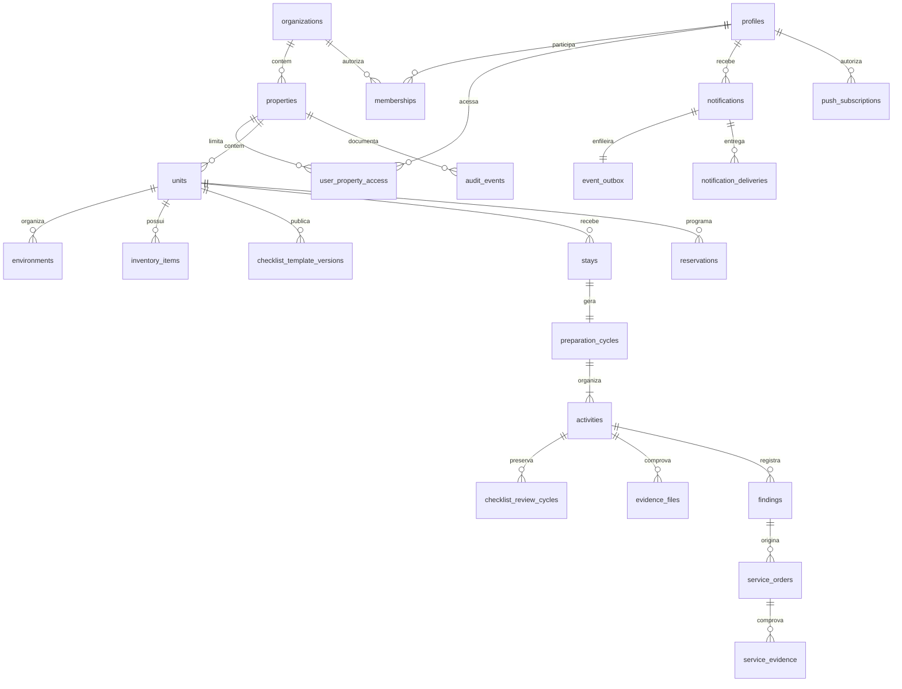

# Arquitetura e decisões

## Camadas

React/TypeScript estrito, Vite e Tailwind compõem a aplicação. React Router controla as telas; TanStack Query consulta e invalida o estado remoto. React Hook Form e Zod validam os formulários. Componentes nativos, labels, foco visível, `<dialog>` modal e preferência global de fonte simplificam a acessibilidade. Não há bibliotecas de calendário, gráficos ou editores complexos sem necessidade.

Supabase Auth fornece a identidade. O browser utiliza a chave pública e o JWT individual. As leituras usam RLS. Alterações críticas são RPCs Postgres, sem permissão de INSERT/UPDATE/DELETE nas tabelas para clientes autenticados. A API Node fornece uma fachada de operações e o recebimento seguro de evidências. A validação final de workflow está no banco, inclusive para chamadas que não passam pela interface.

Não há filas em memória. O consumidor de push é uma função Node curta, chamada por um agendador externo/Vercel Cron com secret. A fila, os leases, as tentativas e o estado ficam no PostgreSQL.

## Relações

Estrutura, usuários, hospedagens, atividades, ocorrências, evidências e serviços são relacionais. Itens versionados e respostas são JSONB para preservar snapshots completos. É uma escolha deliberada da primeira implementação: um editor compartilhado com herança por empreendimento e tabelas normalizadas de regras ainda precisa ser desenvolvido. Não há duplicação de dois checklists para limpeza e check-in.

## Matriz de acesso

| Recurso | Administrador | Gestor autorizado | Vistoriador | Limpeza |
| --- | --- | --- | --- | --- |
| Propriedades | todas da organização | propriedades autorizadas | autorizadas | autorizadas |
| Equipe e funções | administra | consulta perfis disponíveis | próprio perfil | próprio perfil |
| Padrões e inventário | administra | administra no escopo | consulta | consulta |
| Atividades | agenda e consulta | agenda e consulta no escopo | executa atribuídas | executa atribuídas |
| Revisão | se não executou | se não executou | não | não |
| Serviços | cria/revisa | cria/revisa no escopo | executa atribuídos | executa atribuídos |
| Auditoria | consulta/exporta no escopo | consulta/exporta no escopo | não | não |
| Notificações | próprias | próprias | próprias | próprias |

Um administrador precisa também da função operacional correspondente para receber vistoria/limpeza. Um gestor não tem acesso implícito a propriedades sem autorização. RLS é aplicada independentemente do menu visível. Permissões da interface servem à usabilidade, não à segurança. A desativação preserva os registros e exige reatribuição das atividades abertas.

## Fluxos e concorrência

1. `confirm_checkout`: bloqueia a unidade, verifica idempotência pelo ID do evento, identifica ocupação de reserva ou padrão-base, cria estadia, ciclo e exatamente duas atividades. Templates são copiados como snapshots. Gera auditoria e notificações na mesma transação.
2. `activity_action`: `pending → in_progress → completed` para vistoria; `pending → in_progress → review → completed` para limpeza. Decisões de correção preservam a submissão anterior, abrem nova tentativa e limpam somente as respostas devolvidas.
3. Aprovação verifica todas as exigências, vistoria concluída, inexistência de bloqueios e impedimento de autoaprovação. A auditoria também identifica executores anteriores a reatribuições.
4. Uma nova reserva após liberação compara o checklist aplicável à nova ocupação com a última preparação aprovada. Diferenças geram atividade complementar; retirada de itens condicionais também exige conferência. Sem alterações materiais, apenas atualiza a ocupação atendida, mantendo auditoria.
5. Serviços exigem responsável e revisão independente. Conclusão exige evidência textual e fotografia verificada. Ocorrências impeditivas devem ser resolvidas por gestor com justificativa. Uma ordem aprovada não libera automaticamente o imóvel.

Bloqueios `FOR UPDATE` serializam as mutações de cada atividade/unidade. Revisões inteiras controlam concorrência otimista e retornam `CONFLICT`. IDs de eventos evitam ciclos duplicados. Alterar programação ou cancelar exige justificativa. As datas são produzidas pelo banco em UTC e mostradas em America/Sao_Paulo.

## Auditoria e evidências

`audit_events` registra UUID, ator, funções, propriedade, recurso, evento, dados anteriores/posteriores, justificativa, correlação e horário oficial. Não existe API comum de edição ou exclusão. Os privilégios de superusuário/operador de banco ainda exigem governança e backups; append-only para usuários operacionais não significa proteção contra um administrador do banco.

A migração 005 identifica reconciliações automáticas com ator **Sistema**, preserva as versões anteriores e não altera snapshots de atividades. O editor publica novas versões dos dois padrões em uma transação quando há alterações nos itens com quantidade; tarefas de limpeza e conferências técnicas permanecem específicas de cada tipo. A prévia administrativa não cria atividades nem salva respostas. Veja [o guia de atualização](ATUALIZACAO_CHECKLISTS.md).

Buckets privados separam referências, execução e serviços. Objetos usam caminhos UUID e não possuem políticas de sobrescrita ou exclusão pelos usuários. URLs assinadas duram 120 segundos. A API recebe o ID do objeto, verifica identidade e atribuição, baixa os bytes no servidor, verifica assinatura básica de formato e tamanho e calcula SHA-256. Só a função de servidor registra o recibo. Referências são apontadas pelos snapshots das versões; uma nova referência recebe outro caminho.

Fotos não provam automaticamente presença física. O sistema não atribui culpa ao hóspede. Limites atuais: referências não têm o mesmo recibo/hash das fotos de execução, não há miniaturas separadas e arquivos enviados cuja confirmação falhou podem ficar órfãos. Um job de reconciliação deve preservar tudo que estiver ligado a uma execução e remover órfãos somente após retenção definida.

## Operação, retenção e custos

- Configure retenção de hóspedes, auditoria e fotos com o controlador dos dados. A aplicação não exclui silenciosamente históricos. Exporte e teste recuperação de backups conforme os recursos do plano Supabase.
- Faça migrações primeiro em homologação. Backup e restauração precisam ser exercitados com o banco real, inclusive com arquivos do Storage.
- Monitore logs de erro Vercel, falhas na fila e quotas Supabase. Integração com um serviço de monitoramento ainda não foi ligada.
- Fotos originais e tráfego de download tendem a ser os principais custos variáveis. Redimensionar somente miniaturas futuras, preservando originais, reduz o tráfego de revisão.
- Frequência de Cron, backups, retenção e infraestrutura podem exigir planos pagos. Não foi feita contratação nem assumido preço fixo.
- Confirme a política de privacidade, base legal, retenção e atendimento aos titulares antes de operação pública. Não existe declaração de conformidade jurídica automática.

Referências técnicas consultadas: [RLS Supabase](https://supabase.com/docs/guides/database/postgres/row-level-security), [Storage e controle de acesso](https://supabase.com/docs/guides/storage/security/access-control), [funções Node.js na Vercel](https://vercel.com/docs/functions/runtimes/node-js).
