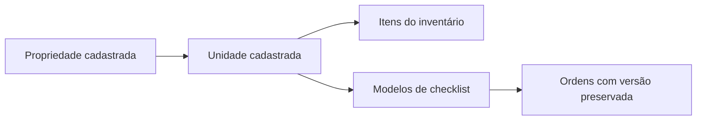

# Avaliação do sistema AJA Anfitrião

**Data:** 16 de outubro de 2026  
**Objetivo:** reduzir dúvidas, preenchimento repetitivo e navegação desnecessária, com prioridade para o uso no celular.

## Parecer

O sistema já tem uma base funcional consistente: modelos versionados, check-in que gera checkout vinculado, três status visíveis para as ordens, envio para aprovação, rascunhos e histórico das decisões. A oportunidade principal agora é organizar melhor o que já existe. Criar novas telas antes de simplificar a navegação tende a aumentar a sobreposição.

Recomendo priorizar **uma agenda operacional clara, relatórios que incluam todas as ordens e consultas que não percam registros com o crescimento da operação**. Para quem preenche, o próximo ganho está em reduzir o espaço ocupado por controles de itens conformes e facilitar a retomada das pendências.

Nesta entrega foram implementados o vínculo visível do inventário com propriedade/unidade, sua edição e ajustes pontuais de clareza. As propostas restantes estão identificadas abaixo e não foram aplicadas como mudanças de regra de negócio.

## Como a avaliação foi feita

- Revisão dos componentes de login, navegação, dashboard, agenda, propriedades, modelos, execução, aprovação, inventário, equipe, relatórios e configuração do aparelho.
- Leitura das funções, relações, permissões e migrações do banco, além da documentação.
- Testes automatizados de domínio, componentes e PostgreSQL embarcado, carregando todas as migrações.
- Inspeção interativa dos componentes reais de inventário em ambiente local, com dados fictícios: telas de 320, 390 e 1.440 pixels, unidades com o mesmo nome, nomes longos, filtros, cadastro e edição.

**Limites:** esta é uma avaliação do código e dos fluxos disponíveis localmente. Não houve acesso autenticado à operação em produção, entrevistas com a equipe, medição de tempo com usuários ou auditoria completa de acessibilidade. Os testes locais não comprovam a configuração do Supabase remoto, a publicação na Vercel, a entrega de push ou o funcionamento em aparelhos físicos. Não foram atribuídas notas de usabilidade nem estimativas de economia sem medição.

## Melhorias implementadas nesta entrega

| Área                     | Problema encontrado                                                                                                              | Resultado entregue                                                                                                                                                                                           |
| ------------------------ | -------------------------------------------------------------------------------------------------------------------------------- | ------------------------------------------------------------------------------------------------------------------------------------------------------------------------------------------------------------ |
| Vínculo do inventário    | A unidade era obrigatória no banco, mas o cadastro não mostrava a propriedade e apresentava todas as unidades misturadas.        | Cadastro em Propriedade → Unidade. O seletor de unidade acompanha a propriedade; itens sem unidade válida não podem ser salvos.                                                                              |
| Consulta do inventário   | Tabela horizontal, nomes de unidade ambíguos e ausência de acesso ao contexto do item.                                           | Lista agrupada por propriedade/unidade, quantidade em linha, acesso à propriedade e aos detalhes da unidade.                                                                                                 |
| Edição do inventário     | O item podia ser cadastrado, mas não havia ação de edição.                                                                       | Edição de nome, quantidade, ambiente, categoria e unidade. Mudanças de vínculo exigem autorização nos dois locais e ficam na auditoria; os controles de edição respeitam a função do usuário na organização. |
| Acesso pela unidade      | Não havia um caminho direto da unidade para seus itens.                                                                          | “Ver inventário” nos detalhes da unidade, com contagem e filtro já aplicado. O link mantém a unidade na URL.                                                                                                 |
| Filtros e estados vazios | Uma busca sem resultado podia deixar uma tabela vazia sem orientação. A busca considerava apenas o nome do item.                 | Busca por item, ambiente, categoria, unidade e propriedade, sem exigir acentos; resultado vazio orienta a limpar os filtros.                                                                                 |
| Cadastro rápido          | Era necessário reencontrar a unidade ao cadastrar pelo seu contexto.                                                             | Unidade/propriedade já preenchidas ao abrir a partir de uma unidade; sugestões dos ambientes cadastrados e quantidade por mais/menos.                                                                        |
| Dashboard                | Blocos decorativos competiam com os dados operacionais. O resumo de unidades misturava totais gerais e filtrados.                | Remoção dos blocos decorativos; resumo de unidades passa a respeitar a propriedade selecionada.                                                                                                              |
| Clareza das telas        | Data repetida em cadastros, textos genéricos e indicador “Filtros” sem ação. A busca aparecia nos relatórios, mas não era usada. | Data mantida no dashboard, textos mais específicos, remoção do indicador sem ação e da busca não funcional dos relatórios.                                                                                   |
| Documentação             | Havia instruções antigas sobre autoaprovação, envio de progresso e fluxo legado de checkout.                                     | Atualização dos pontos encontrados em arquitetura, cobertura e README; orientação para a migração 014.                                                                                                       |

Os controles novos reutilizam cores, bordas, tipografia e botões do sistema. Na lista, a propriedade é apresentada uma vez por grupo, sem repetir esse caminho em cada linha. Ao filtrar uma unidade, o botão contextual de adicionar desaparece porque “Novo item” já abre com esse vínculo preenchido.

## Como funciona o vínculo do inventário

Cada item pertence a **uma unidade**. A propriedade é obtida a partir dessa unidade, evitando duas informações que possam ficar diferentes. Unidades com o mesmo nome em propriedades distintas são diferenciadas pelo caminho completo.

Exemplo: **Residencial Praia → Apartamento 101 → Toalhas de banho: 4 unidades**.

O gestor pode editar esse registro e mudar seu vínculo para outra unidade da mesma organização. A operação verifica as permissões de origem e destino e registra os dados anteriores e posteriores. Se duas pessoas editarem a mesma versão, a segunda alteração é recusada para impedir que apague a primeira.

**Quantidade padrão não é um saldo de movimentação.** Ela define a referência cadastrada. Uma divergência encontrada em vistoria não reduz automaticamente esse valor. Além disso, editar o inventário não reescreve modelos publicados nem ordens existentes. A importação para o modelo continua sendo uma cópia explícita dos itens da unidade.

## Propostas para avaliar

Prioridade **P1:** próximo ciclo, por afetar a leitura da operação ou a execução. **P2:** ganho de praticidade e consistência. **P3:** evolução posterior. Esforço relativo: **pequeno**, alteração localizada; **médio**, envolve mais de um fluxo; **grande**, exige mudanças de dados e integração. Não são estimativas em dias.

| ID  | Prioridade | Proposta                                                                                                   | Benefício esperado                                                             | Esforço |
| --- | ---------- | ---------------------------------------------------------------------------------------------------------- | ------------------------------------------------------------------------------ | ------- |
| P01 | P1         | Unificar agenda de execução e ordens em uma visão com filtros; manter Meu dia como recorte do responsável. | Menos dúvida sobre onde criar, acompanhar e executar.                          | Grande  |
| P02 | P1         | Incluir tarefas simples nos resultados e exportações dos relatórios.                                       | Visão completa da operação, compatível com as ordens do dashboard.             | Médio   |
| P03 | P1         | Paginar e filtrar consultas no servidor, por tela e período.                                               | Evitar listas e indicadores incompletos quando houver mais de 1.000 registros. | Grande  |
| P04 | P1         | Compactar os itens conformes do checklist e oferecer navegação entre pendências.                           | Menos rolagem e controles repetidos durante a conferência.                     | Médio   |
| P05 | P1         | Homologar o fluxo publicado com gestor e executor, incluindo upload, retomada e push.                      | Confirmar o comportamento real fora dos testes locais.                         | Médio   |
| P06 | P2         | Sinalizar diferenças entre o inventário atual e os itens importados de um modelo.                          | Reduzir a manutenção manual de referências de quantidade.                      | Grande  |
| P07 | P2         | Oferecer ajuste de quantidades e duplicação do inventário de uma unidade para outra, em lote.              | Acelerar a preparação de novas unidades semelhantes.                           | Médio   |
| P08 | P2         | Permitir edição de propriedades/unidades e padronizar os nomes usados nas telas.                           | Corrigir dados sem depender de intervenção no banco e reduzir ambiguidade.     | Médio   |
| P09 | P2         | Simplificar cadastro de equipe com convite e definição de função/escopo no próprio fluxo.                  | Remover a etapa manual no painel do Supabase.                                  | Grande  |
| P10 | P2         | Unificar o comportamento de busca e filtros entre agenda, dashboard e listas.                              | Evitar que um filtro pareça aplicado, mas afete só parte da tela.              | Médio   |
| P11 | P2         | Consolidar estilos e componentes compartilhados das telas administrativas.                                 | Manter tamanhos e cores coerentes e reduzir regressões no responsivo.          | Médio   |
| P12 | P2         | Melhorar o envio de evidências com progresso por arquivo e nova tentativa isolada.                         | Facilitar o uso em conexão instável, especialmente com vídeo.                  | Grande  |
| P13 | P3         | Criar indicadores de divergências recorrentes por unidade/item.                                            | Ajudar o gestor a identificar problemas que se repetem.                        | Grande  |

### P01 — Uma agenda, diferentes recortes

**Evidência:** `App.tsx` monta a agenda de estadias no dashboard, em Meu dia e na Agenda de execução. Também há uma tela de Ordens de serviço com acesso aos mesmos registros de execução. O problema observado é sobreposição de apresentação, não evidência de duplicação das ordens no banco.

**Proposta:** manter o dashboard como resumo do dia; uma tela “Ordens” com alternância Lista/Calendário e filtros de data, responsável, tipo e status; “Meu dia” como atalho para as ordens atribuídas. A agenda compartilhada por propriedade continua disponível para todos os perfis autorizados.

**Critério de aceite:** a mesma ordem tem um único detalhe, independente do caminho usado; criar check-in continua gerando exatamente um checkout; o gestor altera a saída sem recriar a estadia; a equipe encontra as entradas e saídas do dia sem alternar entre duas agendas.

**Decisão necessária:** confirmar quais entradas do menu devem permanecer como atalhos. Não remover o acesso à agenda compartilhada para reduzir o menu.

### P02 — Relatórios completos

**Evidência:** `Reports.tsx` calcula e exporta a partir de `data.activities`. Tarefas simples são ordens em `service_orders` sem atividade associada e, portanto, não entram nesses totais. Isso explica uma possível diferença entre relatórios e contadores operacionais, mesmo que ambos estejam funcionando conforme o código.

**Proposta:** combinar execuções de checklist e tarefas simples, sem contar uma ordem com checklist duas vezes. Mostrar explicitamente o critério de data escolhido: programação, envio ou aprovação. Identificar propriedade e unidade na exportação.

**Critério de aceite:** uma amostra com um check-in, seu checkout e uma tarefa mostra três ordens; uma execução vinculada à ordem conta uma vez; filtros e CSV retornam os mesmos registros. Médias devem informar quais registros possuem horários suficientes para o cálculo.

### P03 — Consultas sem corte de registros

**Evidência:** `loadData`, em `src/lib/client.ts`, consulta todas as tabelas com `select('*').limit(1000)`. Os filtros das telas são majoritariamente locais. O relatório informa esse limite, mas agendas e indicadores podem trabalhar com um conjunto incompleto quando o volume crescer. Não foi verificado se a produção já atingiu esse volume.

**Proposta:** consultas por recurso, filtros no banco, ordenação definida, paginação e agregações para contadores. Carregar histórico e auditoria sob demanda. Manter o snapshot offline mínimo por usuário.

**Critério de aceite:** uma base de homologação com mais de 1.000 ordens continua mostrando corretamente o dia atual, as aprovações pendentes e os totais do período, incluindo registros fora da primeira página.

### P04 — Conferência com menos rolagem

**Evidência:** a execução já permite marcar o check antes de alterar a quantidade, calcula divergência, mantém hóspedes/diárias visíveis, salva rascunho e oferece envio único para aprovação. Esses ganhos devem ser preservados. Ainda há um seletor de condição por item de quantidade, mesmo quando tudo está conforme.

**Proposta:** apresentar uma linha com check, nome e quantidade; mostrar “Conforme” de modo compacto e abrir as três condições ao tocar. Divergência continua automática e aparece abaixo do contador. Observação e controles de problema aparecem quando necessários. Oferecer “Próxima pendência” para itens ainda não conferidos e manter todos os itens acessíveis.

**Critério de aceite:** conferir itens conformes sem abrir detalhes, registrar dano sem procurar um campo em outra seção e chegar diretamente à primeira pendência. A conferência continua individual por item, sem introduzir uma ação de confirmar todos em lote.

### P05 — Homologação do ambiente publicado

**Evidência:** existem PWA, tela de configuração por aparelho, upload privado, fila de notificações e recuperação de rascunhos. Os testes usam substitutos locais de Auth/Storage; não comprovam conectividade, permissões nativas ou entrega no aparelho.

**Roteiro:** criar um check-in, conferir o checkout gerado e a agenda da equipe; iniciar e preencher; salvar rascunho; interromper a conexão; retomar; enviar foto e vídeo; aprovar com gestor e com o próprio gestor executor; devolver uma correção; testar instalação e recebimento de aviso em aparelhos reais. Validar que usuário sem acesso à propriedade não vê seus itens ou evidências.

**Critério de aceite:** registrar os resultados por aparelho e conta, incluindo falhas e recuperação. Conferir migrações, variáveis, APIs e agendador no ambiente publicado. Esta etapa permanece pendente de ambiente remoto; não está concluída por esta entrega.

### P06 e P07 — Inventário como referência prática

**Evidência:** a função `importInventory` do editor copia nome, ambiente e quantidade dos itens da unidade. Não há uma sincronização permanente entre o item do inventário e todas as versões do modelo. Alterar a referência pode exigir revisão manual de vários modelos.

**Proposta:** identificar a origem do item importado e oferecer uma comparação “inventário atual × modelo” antes de publicar nova versão. Para novas unidades, permitir copiar um conjunto de itens e ajustar quantidades numa lista única. Avaliar aviso de nome/ambiente já cadastrado para evitar duplicações acidentais.

**Critério de aceite:** a atualização exige uma escolha explícita do gestor; versões publicadas e ordens já abertas preservam seu conteúdo; a cópia sempre cria registros associados à unidade de destino. Não sincronizar silenciosamente uma execução em andamento.

**Decisão necessária:** confirmar se existe estoque compartilhado da propriedade, além dos itens de cada unidade. O vínculo entregue considera cada item pertencente a uma unidade; um almoxarifado comum precisaria de outro fluxo.

### P08 a P13 — Simplificação e sustentação

- **Propriedades/unidades:** os formulários atuais concentram criação e ambientes. Acrescentar edição com validação e histórico. Usar “Propriedade” como nome principal; há alternância com “Empreendimento” na interface.
- **Equipe:** `MemberEditor` exige usuário criado previamente no Supabase Auth. Um convite integrado deve manter as permissões por propriedade e tratar e-mails já existentes, expiração e reenvio.
- **Busca e filtros:** `StayAgenda` recebe a propriedade, mas não recebe o texto da busca global; relatórios têm filtros próprios; outros filtros permanecem entre telas. Tornar explícito o escopo e evitar manter termos que não afetam a tela aberta.
- **Design e manutenção:** `App.tsx` concentra muitas telas e estados; `style.css` contém camadas sucessivas de regras, inclusive redefinições de cores e botões. Extrair telas e consolidar tokens de cor, espaçamento, controles e estados vazios. Testar também fonte ampliada, teclado e foco, além da largura da tela.
- **Evidências:** hoje há limite por arquivo e validação de mídia, mas não fila offline de arquivos. A evolução deve permitir nova tentativa só do arquivo que falhou, sem perder os demais recibos ou as respostas. Avaliar miniaturas para revisão, preservando originais.
- **Recorrência:** o gestor deve ver divergências confirmadas por item e unidade ao longo do tempo. Antes disso, definir identidade estável dos itens, ajuste de referência e quais ocorrências entram no indicador. Quantidade padrão e quantidade encontrada precisam continuar distinguíveis.

## Sequência sugerida

1. **Ativar e conferir esta entrega:** aplicar a migração 014, publicar o frontend e conferir cadastro/edição dos itens com duas propriedades.
2. **Confiabilidade da operação:** P02, P03 e P05. Relatórios completos, consultas sem corte e homologação real.
3. **Rapidez no celular:** P01, P04 e P10. Navegação, conferência e filtros com regras consistentes.
4. **Cadastro e manutenção:** P06 a P09, P11 e P12. Reutilizar referências, simplificar equipe e consolidar interface.
5. **Gestão por recorrência:** P13, depois de definir a identidade dos itens e os critérios dos indicadores.

A ordem pode ser ajustada após observar a equipe executando um check-in e um checkout completos. Medir tempo de preenchimento, número de retornos por dúvida e tentativas de envio com falha antes/depois; não há linha de base medida nesta avaliação.

## Ativação do inventário entregue

1. No Supabase, aplicar **uma vez**, após a migração 013, o arquivo [`202610160014_inventory_links.sql`](../supabase/migrations/202610160014_inventory_links.sql). Ele adiciona revisão, índice e a função de gravação; mantém as relações e os itens existentes.
2. Publicar o frontend atualizado. Sem a função nova no banco, cadastrar/editar apresentará uma mensagem orientando a aplicar a migração.
3. Em Inventário, cadastrar escolhendo propriedade e unidade. Abrir a edição pelo lápis. Em Propriedades, abrir a unidade e usar “Ver inventário”.
4. Se necessário, mudar a unidade/propriedade de um item e conferir a auditoria de origem e destino. O usuário precisa poder gerenciar ambos os locais, dentro da mesma organização.

A migração remota e a publicação não foram executadas nesta avaliação. Não são necessárias novas variáveis de ambiente para este vínculo.

## Verificações desta entrega

- **152 testes aprovados em 11 arquivos**, incluindo 13 cenários novos para inventário entre componentes e banco.
- Testes do vínculo obrigatório, propriedade derivada, filtros, nomes de unidade iguais, busca sem acento, edição, revisão concorrente, auditoria, bloqueio de escrita direta e permissões de origem/destino e entre organizações.
- Build de produção com TypeScript/Vite concluído.
- Navegador local: cadastro pré-preenchido, troca de propriedade com atualização das unidades, impedimento de salvar sem unidade, quantidade por seletor, estado vazio e leitura em 320/390/1.440 pixels. Não foi encontrado transbordamento horizontal nesses componentes nas dimensões verificadas.
- As gravações foram exercitadas no PostgreSQL de testes. A página usada para inspeção visual usa dados fictícios e não grava no Supabase remoto.

Capturas da nova interface, com dados de exemplo:

- [Inventário no celular](screenshots/inventario-mobile.png)
- [Cadastro no celular](screenshots/inventario-cadastro-mobile.png)
- [Inventário no computador](screenshots/inventario-desktop.png)

## Referências no projeto

- [Navegação, dashboard e atalhos](../src/App.tsx)
- [Catálogo do inventário](../src/features/InventoryCatalog.tsx) e [cadastro/edição](../src/features/InventoryEditor.tsx)
- [Busca e agrupamento do inventário](../src/features/inventory.ts)
- [Execução do checklist](../src/features/ActivityDetail.tsx) e [editor de modelos](../src/features/TemplateEditor.tsx)
- [Agenda compartilhada](../src/features/StayAgenda.tsx) e [criação de ordens](../src/features/WorkOrderEditor.tsx)
- [Relatórios](../src/features/Reports.tsx), [consultas e rascunhos](../src/lib/client.ts) e [equipe](../src/management.tsx)
- [Testes de inventário](../tests/inventory.test.tsx) e [testes do banco](../tests/database.test.ts)
